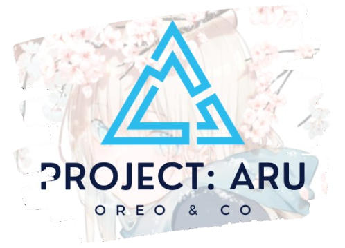

# ProjectAru
<!-- a dedicated discord bot for my private discord server.
one of the first projects that got me into coding.featuring a lot of if statements and cringe jokes.
uploaded to github for nostalgia purposes. -->

A dedicated Discord bot for my private server, one of the first projects that got me into coding. Packed with lots of if statements and cringe jokes. Uploaded here for nostalgia purposes.

<div align="center">
 

*Project Aru, a dedicated discord bot for No System*

</div>

## Features
- a multi-purpose discord bot with (almost) every tool for a server
- prefixes instead of slash commands just like the founding fathers intended
- minigames!
- ai integration, bring your own haluan
- :D eeh i'll finish this later

<!-- might gonna need this later -->
<!-- <table>
  <tr>
    <td></td>
    <td>
      <p>
        knhjxarnkarxnkhnxkfxknfkxnzfbh something
      </p>
    </td>
  </tr>
</table> -->

## Installation guide
1. install all required dependency

``` sh
pnpm install
```
2. create an `.env` file from `.env.tamplate`
- himitsu → discord bot token
- OWU_URL → Open WebUI api key
- MODEL_NAME → AI model to use


3. start bot
``` sh
pnpm dev
```
4. deploying into container
``` sh
docker compose build --no-cache
docker compose up
```
